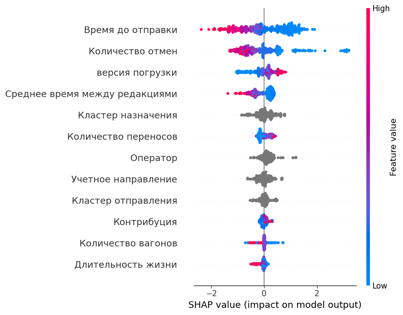
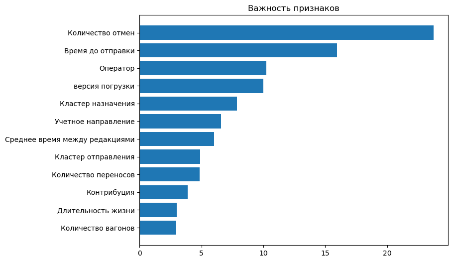

# Прогноз выполнения заявок на ж/д-перевозку: статистика, CatBoost и SHAP

🇷🇺 Русский · [🇬🇧 English](#-english)

**Задача.** Логистическая компания ежедневно получает заявки на железнодорожную перевозку, и часть из них переносится или отменяется. Нужно понять, какие факторы влияют на выполнение заявки, и построить модель, которая заранее оценивает вероятность её выполнения. Это помогает планировать вагоны и работу операторов.

**Данные.** 3 190 заявок за январь – сентябрь 2023 года: направление и кластеры отправления и назначения, число вагонов, контрибуция, история редактирований, переносов и отмен, оператор, результат (выполнена / не выполнена). ⚠️ Датасет предоставлен в рамках учебного курса и содержит логины сотрудников, поэтому в репозиторий не включён. В выводах ноутбуков операторы обезличены.

**Формат.** Учебный проект, 4 курс (7–8 семестры).

## Что сделано

**1. Распределения признаков** ([`01_eda_distributions.ipynb`](notebooks/01_eda_distributions.ipynb))
- Описательные статистики 10 количественных признаков.
- Проверка нормальности пятью способами: гистограммы, кумулятивные распределения, Q-Q графики, коэффициенты асимметрии и эксцесса, тест Колмогорова–Смирнова.
- Интерактивные графики на **Dash** (выбор признака из выпадающего списка).
- Вывод: все признаки значимо отличаются от нормального распределения (p ≈ 0) и имеют тяжёлые правые хвосты, поэтому для сравнения групп нужны непараметрические методы.

**2. Модель** ([`02_catboost_shap.ipynb`](notebooks/02_catboost_shap.ipynb))
- **Защита от утечки данных:** удалены признаки, которые становятся известны только после отправки (редакции после отправки, длительность «афтершока», фактическая дата).
- **Временная валидация:** обучение на январе–августе, тест на сентябре. Так модель проверяется в условиях, близких к реальным.
- **CatBoost** с нативной обработкой категориальных признаков и подбором `iterations`, `one_hot_max_size`, `bagging_temperature` через GridSearchCV по ROC-AUC.
- Интерпретация: важность признаков и **SHAP**.
- **Dash-интерфейс** для просмотра деревьев модели.

## Ключевые результаты

- **ROC-AUC 0,84 на кросс-валидации и 0,79 на отложенном сентябре**, accuracy 0,71.
- Главные факторы — **число отмен в истории заявки** и **время до отправки**. По SHAP заявки, созданные задолго до отправки, и заявки с отменами в истории выполняются реже. Дальше по важности идут оператор и версия погрузки.
- **Практический вывод:** заявки с отменами в истории и с большим горизонтом планирования стоит отдельно подтверждать у клиента. Различия между операторами — повод разобрать практики работы с заявками.

## Что бы я улучшил

- Подобрать порог классификации под бизнес-цель (например, максимальный recall для рискованных заявок) и оценить precision/recall, а не только accuracy.
- Проверить стабильность качества на нескольких временных окнах (rolling validation).

## Стек

Python · pandas · SciPy · CatBoost · SHAP · scikit-learn · Dash · matplotlib

---

## 🇬🇧 English

**Predicting rail freight order fulfilment: statistics, CatBoost and SHAP**

3,190 rail freight orders (Jan–Sep 2023). The dataset comes from a university course and contains employee logins, so it is not published; operators are anonymised in the notebook outputs.

- **EDA:** normality checks with histograms, CDFs, Q-Q plots, skewness and kurtosis, and the KS test, plus interactive Dash charts. All features are heavily skewed and non-normal.
- **Model:** CatBoost with native categorical handling, GridSearchCV on ROC-AUC, post-shipment features removed to avoid leakage, and a **time-based split** (train Jan–Aug, test Sep).
- **Results:** **ROC-AUC 0.84 (CV) / 0.79 (hold-out September)**. The number of past cancellations and the lead time to shipment are the strongest drivers (feature importance and SHAP). A Dash app visualises the model's trees.

**Stack:** Python, pandas, SciPy, CatBoost, SHAP, scikit-learn, Dash.
