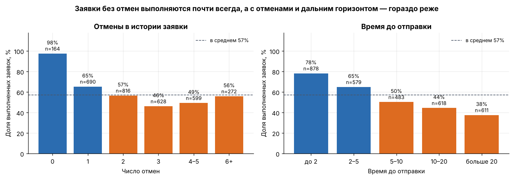
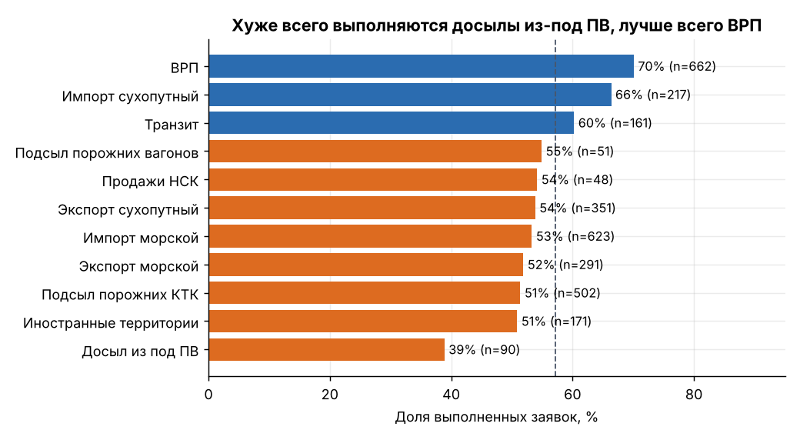

# Прогноз выполнения заявок на ж/д-перевозку

Учебный проект, 4 курс СПбГЭУ. Логистическая компания каждый день получает заявки на перевозку грузов вагонами, и больше 40% из них в итоге переносится или отменяется. Задача: понять, от чего это зависит, и научиться заранее оценивать вероятность, что заявка будет выполнена. Это помогает планировать вагоны и работу операторов.

[English version below](#english)

## Данные

3 169 заявок за январь–сентябрь 2023 года: направление, кластеры отправления и назначения, число вагонов, контрибуция, история редактирований, переносов и отмен, оператор, итоговый результат. Выполняется 57% заявок.

Датасет выдан в рамках курса и содержит логины сотрудников, поэтому в репозитории его нет. Операторы в ноутбуках обезличены.

## Что влияет на выполнение заявки

**История отмен — самый сильный сигнал.** Заявки, которые ни разу не отменялись, выполняются в 98% случаев. После первой отмены доля падает до 65%, после трёх и больше — до 46–56%.

**Чем дальше отправка, тем ниже шанс.** Заявки с отправкой в ближайшие 2 дня выполняются в 78% случаев, а при горизонте больше 20 — только в 38%. Планы на далёкое будущее чаще пересматривают.

**Направление тоже важно.** Лучше всего выполняются ВРП (70%) и сухопутный импорт (66%), хуже всего досылы из-под ПВ (39%).

## Модель

- **CatBoost** с нативной обработкой категориальных признаков, гиперпараметры подбирал через GridSearchCV по ROC-AUC.
- **Без утечки данных:** убрал признаки, которые становятся известны только после отправки (редакции после отправки, фактическая дата, длительность «афтершока»).
- **Разбиение по времени:** обучение на январе–августе, проверка на сентябре, как было бы в реальной работе.

**Результат: ROC-AUC 0,84 на кросс-валидации и 0,79 на сентябре**, accuracy 0,71.

SHAP показывает то же, что и графики выше: модель сильнее всего опирается на число отмен и время до отправки, дальше идут оператор и версия заявки. Красные точки (большие значения признака) слева означают, что они снижают шанс выполнения.

**Как это использовать:** заявки с отменами в истории и с дальним горизонтом стоит отдельно подтверждать у клиента, а под них не резервировать вагоны заранее. Разброс между операторами — повод разобрать их практики работы с заявками.

## Что бы улучшил

Подобрать порог классификации под задачу бизнеса (например, чтобы не пропускать рискованные заявки) и проверить стабильность модели на нескольких месяцах подряд, а не на одном сентябре.

## Файлы

- `notebooks/01_eda_distributions.ipynb`: распределения признаков, проверка на нормальность, интерактивные графики на Dash.
- `notebooks/02_catboost_shap.ipynb`: модель, важность признаков, SHAP, Dash-интерфейс для просмотра деревьев.
- `scripts/make_figures.py`: графики для README (нужен исходный датасет).

Python, pandas, SciPy, CatBoost, SHAP, scikit-learn, Dash.

---

## English

**Predicting rail freight order fulfilment (3,169 orders, Jan–Sep 2023).** Orders with no past cancellations are fulfilled 98% of the time, compared with 65% after one cancellation and under 56% after three or more. Fulfilment also drops from 78% to 38% as lead time grows. A CatBoost model with leakage-free features and a time-based split reaches ROC-AUC 0.84 in cross-validation and 0.79 on the hold-out month, and SHAP confirms the same drivers. The data contains employee logins, so it is not published.
